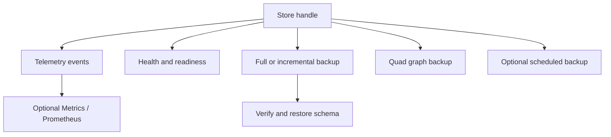

# Operations and recovery

## Chapter record

| Field | Value |
| --- | --- |
| Step | `5` |
| Inspected revision | `29608a6217a7db4204fc2f583978451805afd8fb` |
| State | `current` |
| Scope | Connect telemetry and health to full-store and graph-scoped recovery paths. |

## Problem and mental model

The embedded store still needs observability, a way to judge health, and
recovery paths that preserve its selected persisted schema. These are related
operator surfaces but have different ownership and guarantees.

## Important files

- `lib/triple_store/telemetry.ex` names events and sanitizes operator-facing
  metadata, including query text and paths.
- `lib/triple_store/health.ex` supplies liveness, readiness, and richer health
  status beyond the facade's compact `health/1` result.
- `lib/triple_store/backup.ex` creates, verifies, and restores full or
  incremental store backups while detecting the persisted schema.
- `lib/triple_store/graph_backup.ex` exports and imports one named graph with
  graph-aware metadata rather than copying a whole DB directory.
- `lib/triple_store/scheduled_backup.ex` runs optional rotating backups and
  monitors the store lifecycle to stop after shutdown.
- `lib/triple_store/snapshot.ex` owns the globally supervised snapshot
  support surface; a snapshot's existence alone is no claim about facade
  query isolation.
- `test/triple_store/backup_test.exs` covers full-store backup behavior.
- `test/triple_store/health_test.exs` covers health states.

## Execution flow

1. API operations emit telemetry spans or events. `Telemetry` reduces raw
   data before it becomes operator metadata. Optional `Metrics` and
   `Prometheus` consumers may subscribe; opening a store does not start them.
2. `TripleStore.health/1` returns a compact summary. Expert `Health`
   functions distinguish liveness, readiness, and fuller state. A missing
   optional helper may degrade full health without making the DB unusable.
3. `TripleStore.backup/3` delegates to `Backup.create/3`; `restore/3`
   delegates to `Backup.restore/3`. Full-store verification and restore detect
   whether the backup is triple or quad and reopen with that schema.
4. `GraphBackup` serves a narrower named-graph recovery workflow using
   N-Quads plus graph metadata. It is not equivalent to a full-store backup of
   indices, ACLs, provenance, and every graph.
5. `schedule_backup/3` starts an optional process. The scheduler monitors the
   dictionary manager as a store-lifetime signal, cancels its work on store
   shutdown, and does not keep scheduling against a closed DB.

## Data, ownership, and lifetime

The default OTP application supervises the snapshot service and plan cache;
metrics, Prometheus, statistics helpers, and scheduled backups are opt-in.
Full-store recovery handles canonical persisted bytes, including the chosen
schema's column families. Graph backup works at a dataset boundary, so it
needs a distinct graph-preservation check. Snapshot resources must be
released by their owner.

## Failure and trust boundaries

The backup module's documented guarantee is strongest for a closed or
quiescent store; active writes can race a file copy. Incremental backups may
hard-link unchanged files and fall back to copying across filesystems.
Restore validates backup metadata and preserves schema identity. A successful
health response is an observation at one time, not proof that a later backup
or query will succeed.

## Tests and evidence limits

The mapped files contain backup and health cases. Additional relevant cases
live in `test/triple_store/graph_backup_test.exs`,
`test/triple_store/scheduled_backup_test.exs`, and
`test/triple_store/telemetry_test.exs`. They are source references here, not
executed results. Full-store restore tests cannot by themselves prove the
same metadata behavior for graph-level export/import.

## Normative connections

The [observability contract](https://github.com/pcharbon70/triple_store/blob/main/specs/contracts/observability_contract.md#requirement-set)
defines event, health, and recovery requirements. The
[operations area spec](https://github.com/pcharbon70/triple_store/blob/main/specs/operations/observability_and_recovery.md#current-codebase-notes)
records current optional services and `AC-OPS-*` evidence. The
[storage contract](https://github.com/pcharbon70/triple_store/blob/main/specs/contracts/storage_runtime_contract.md#requirement-set)
requires schema-aware full-store restore and explicit graph-preservation
boundaries.

## Revision and maintenance

Revisit this chapter and its coverage rows when telemetry metadata, helper
supervision, health classification, backup consistency, schema detection,
graph export, or scheduled-backup lifecycle changes.
