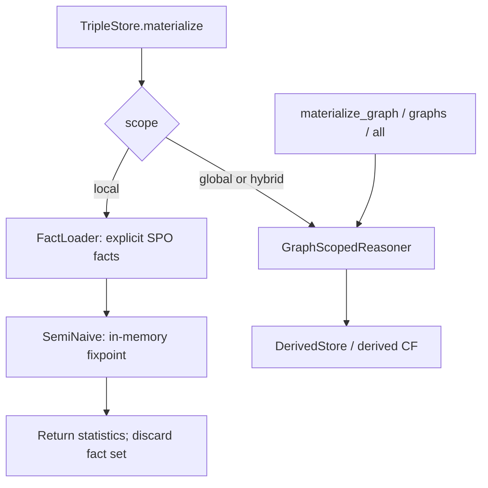

# Reasoning and derived facts

## Chapter record

| Field | Value |
| --- | --- |
| Step | `3` |
| Inspected revision | `29608a6217a7db4204fc2f583978451805afd8fb` |
| State | `current` |
| Scope | Compare local in-memory materialization with graph-scoped derived persistence. |

## Problem and mental model

“Materialize” names more than one current workflow. The default local facade
path computes a fixpoint over explicit triples and returns statistics. Graph
scoped paths can persist inferred quads. Confusing them leads to incorrect
expectations about later query visibility and deletion.

## Important files

- `lib/triple_store/reasoner/reasoning_profile.ex` selects the rule set.
- `lib/triple_store/reasoner/fact_loader.ex` scans explicit SPO facts into a
  complete set and owns its iterator's cleanup.
- `lib/triple_store/reasoner/semi_naive.ex` evaluates rules to a fixpoint using
  delta facts.
- `lib/triple_store/reasoner/graph_scoped_reasoner.ex` coordinates local,
  global, and hybrid graph-aware materialization.
- `lib/triple_store/reasoner/derived_store.ex` persists and looks up derived
  facts separately from the explicit indices.
- `test/triple_store/reasoner/fact_loader_test.exs` exercises scan errors and
  iterator cleanup.
- `test/triple_store/reasoner/graph_scoped_reasoning_integration_test.exs`
  exercises graph-aware reasoning paths.

## Execution flow

1. The facade reads `scope`, defaulting to `:local`. That path selects rules
   from `ReasoningProfile`, loads explicit triple facts through `FactLoader`,
   and calls `SemiNaive.materialize_in_memory/3`.
2. The local evaluator returns a fact set and statistics; the facade returns
   only the statistics. It does not write the fact set to `derived`, reload
   previous derived facts, or forward its `parallel` option to the evaluator.
3. `materialize_graph/3`, `materialize_graphs/3`, `materialize_all/2`, and the
   global or hybrid facade scopes delegate to `GraphScopedReasoner`. Its
   storage callbacks write inferred facts to the separate `derived` surface.
4. `DerivedStore` has different quad tuple order from `QuadOperations`:
   `{g, s, p, o}` versus `{s, p, o, g}`. Graph-scoped paths must convert at
   this boundary. Global `:per_graph_cf` derived keys use canonical GSPO
   encoding under graph ID `0`.

## Data, ownership, and lifetime

Explicit and inferred facts have separate persistence roles. Provenance and
graph scope matter when a derived fact is explained or maintained after a
deletion. `FactLoader` owns its SPO iterator and closes it on completion and
on error. A local fixpoint result exists only in memory after that scan; it
does not become a persisted inferred fact through the default facade call.

## Failure and trust boundaries

Input scan, persisted-key decoding, and storage errors abort local
materialization with tagged errors rather than a partial fact set. Fully
ground premises must be checked through the configured lookup provider; a
provider error aborts evaluation. Derived provenance records are a separate
trust boundary and are validated before explanation or maintained deletion.

## Tests and evidence limits

The mapped tests cover local fact loading and graph-scoped integration.
`test/triple_store/reasoner/ground_premise_regression_test.exs` and
`test/triple_store/reasoner/derived_quad_canonical_test.exs` are further
targeted cases. This chapter records source and test-file inspection, not an
executed reasoning suite. A passing local fixpoint test alone would not prove
persistence, provenance, or later query visibility.

## Normative connections

The [reasoning contract](https://github.com/pcharbon70/triple_store/blob/main/specs/contracts/reasoning_contract.md#requirement-set)
requires explicit/derived separation, graph-aware maintenance, and typed
limits. Its [implementation status](https://github.com/pcharbon70/triple_store/blob/main/specs/contracts/reasoning_contract.md#current-implementation-status)
documents the local facade limitation. The
[reasoning area spec](https://github.com/pcharbon70/triple_store/blob/main/specs/reasoning/materialization_and_maintenance.md#current-codebase-notes)
maps the broader subsystem and relevant `AC-RSN-*` cases.

## Revision and maintenance

Revisit this chapter and its coverage rows when facade scope routing,
FactLoader cleanup, rule evaluation, derived key encoding, graph scope,
provenance, or persistence semantics change.
