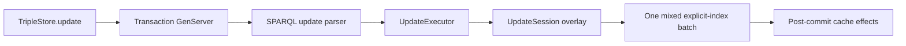

# SPARQL update and transactions

## Chapter record

| Field | Value |
| --- | --- |
| Step | `4` |
| Inspected revision | `29608a6217a7db4204fc2f583978451805afd8fb` |
| State | `current` |
| Scope | Follow serialized update requests through staged operations and one explicit-index batch. |

## Problem and mental model

One SPARQL request may contain several operations. They must observe one
another in order and either commit their explicit-index effects together or
return an error without a partial explicit-index write. The store's managed
coordinator serializes update calls submitted to it; the update executor
stages the request before one storage batch.

## Important files

- `lib/triple_store/transaction.ex` owns the per-store serialized request
  queue and configured plan-cache invalidation.
- `lib/triple_store/sparql/update_executor.ex` interprets typed operations,
  orders them within a request, and publishes successful request effects.
- `lib/triple_store/sparql/update_session.ex` holds the request-local staged
  puts and deletes and commits the final explicit-index view.
- `lib/triple_store/sparql/update/helpers.ex` supports term conversion,
  authorization, and result-cache invalidation.
- `test/triple_store/phase_2_transaction_integration_test.exs` exercises
  both schemas, failed batches, request order, and cache state.
- `test/triple_store/transaction_serialization_test.exs` exercises queue
  ordering on a coordinator.

## Execution flow

1. `TripleStore.open/2` starts a managed coordinator unless the caller passes
   an external one. `TripleStore.update/2` calls the coordinator in the store
   handle. It does not create a new coordinator per call.
2. The coordinator parses the SPARQL update and passes its typed operations to
   `UpdateExecutor`. Calls to the same GenServer run synchronously in queue
   order; an expert `Transaction.query/3` call joins that queue.
3. `UpdateExecutor` stages explicit-index changes in `UpdateSession`. A later
   operation reads earlier staged changes. WHERE templates, graph operations,
   and authorization resolve before the final storage batch.
4. If planning or validation fails, the staged explicit-index changes are
   discarded. On success, the final CF/key mutations form one mixed batch.
   Result cache and configured plan-cache effects occur after a successful
   commit. Unused dictionary IDs may remain after a failed request because
   term allocation can precede the explicit-index commit.
5. Facade `query/3` and direct load, insert, or delete calls bypass the
   coordinator. Its queue therefore provides ordering for participating
   calls, not global isolation for every store operation.

## Data, ownership, and lifetime

The coordinator belongs to the store by default and closes with it. An
external coordinator remains caller-owned. `UpdateSession` is per-request
state and never becomes a separately persisted copy of the store. The batch
updates the appropriate triple or quad explicit indices together. The
`derived` surface and reasoning maintenance have separate semantics.

## Failure and trust boundaries

Unsupported `LOAD` fails before explicit-index commit, even if an earlier
operation in the same request staged a valid write. A failed final batch
returns a tagged storage error and leaves explicit indices unchanged.
Lower-level user-aware contexts can enforce graph ACLs, but the facade
`update/2` does not take an actor option. The coordinator does not create a
snapshot for concurrent reads; expert coordinator queries wait behind
updates, and facade queries run outside that queue.

## Tests and evidence limits

The mapped integration test includes `SCN-008` cases for both schemas and
checks failed-batch state, ordering, cache invalidation, and reopen coherence.
The mapped serialization test covers coordinator order. These test files were
inspected as evidence locations; this chapter does not claim an executed
Elixir suite. One coordinator's ordering does not prove isolation against
direct writes or facade queries.

## Normative connections

The [transaction contract](https://github.com/pcharbon70/triple_store/blob/main/specs/contracts/transaction_and_isolation_contract.md#requirement-set)
requires single-writer coordination, atomic explicit-index fanout, and
honest isolation claims. Its [implementation status](https://github.com/pcharbon70/triple_store/blob/main/specs/contracts/transaction_and_isolation_contract.md#current-implementation-status)
describes the staged overlay and direct-access boundary. The
[query contract](https://github.com/pcharbon70/triple_store/blob/main/specs/contracts/query_execution_contract.md#requirement-set)
governs typed errors, graph authorization hooks, and cache invalidation.

## Revision and maintenance

Revisit this chapter and its coverage rows when coordinator ownership,
request staging, graph authorization, batch failure behavior, cache effects,
or facade routing changes. Recheck both schemas and failed-update cases.
