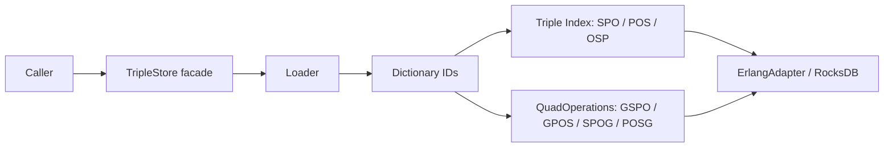

# Store lifecycle and explicit data

## Chapter record

| Field | Value |
| --- | --- |
| Step | `1` |
| Inspected revision | `29608a6217a7db4204fc2f583978451805afd8fb` |
| State | `current` |
| Scope | Follow open, RDF term encoding, schema-specific index writes, and close. |

## Problem and mental model

A caller sees RDF terms and a store handle; RocksDB stores integer keys in a
schema-specific set of column families. The critical path is the conversion
between these views and the atomic fanout of each explicit fact.

## Important files

- `lib/triple_store.ex` validates `open/2`, returns the handle, routes direct
  writes, and owns managed-resource shutdown.
- `lib/triple_store/application.ex` starts the process-global registry, plan
  cache, and snapshot service. Store-local resources start during `open/2`.
- `lib/triple_store/backend/rocksdb/erlang_adapter.ex` owns schema-aware DB
  opening, column-family access, batches, and native resource boundaries.
- `lib/triple_store/dictionary.ex` defines tagged term IDs and encoding rules.
- `lib/triple_store/loader.ex` converts RDF input and selects the direct triple
  or quad write path.
- `lib/triple_store/index.ex` encodes triple keys and fans explicit writes out
  to three indices.
- `lib/triple_store/quad_index.ex` defines quad key orders and pattern lookup.
- `lib/triple_store/quad_operations.ex` writes canonical `{s, p, o, g}` quads
  to four indices in one batch.
- The [SPARQL update chapter](sparql-update-and-transactions.md) owns the
  coordinator detail; direct Loader writes do not enter its queue.
- `test/triple_store/backend/rocksdb/schema_versioning_test.exs` has schema
  reopen and mismatch cases.
- `test/triple_store/quad_operations_test.exs` exercises quad operations.

## Execution flow

1. `TripleStore.open/2` validates the path and selects `:triple` by default or
   `:quad` from the option. `ErlangAdapter.open/2` opens the persisted schema.
   A mismatched reopen returns an error rather than changing the existing
   layout in place.
2. `open/2` starts a dictionary manager, optionally sharded, then a managed
   transaction coordinator unless the caller supplies a live external one. The
   handle records `db`, `dict_manager`, `transaction`, `transaction_owner`,
   `path`, and `schema`. Failures during startup close resources already opened.
3. `load`, `load_graph`, `load_string`, `insert`, and `delete` call Loader. The
   dictionary maps RDF terms to tagged 64-bit IDs; the storage path writes
   explicit triples or quads using the selected persisted schema.
4. Triple writes use `Index` to put `spo`, `pos`, and `osp` keys in one adapter
   batch. Quad writes use `QuadOperations` to put `gspo`, `gpos`, `spog`, and
   `posg` keys in one adapter batch. `0` is the quad default-graph ID.
5. `update/2` takes a different path through the handle's transaction
   coordinator. `query/3` and direct Loader calls bypass that coordinator, so
   the coordinator's queue is not a whole-store lock.
6. `close/1` stops the store-owned coordinator, dictionary manager, and DB
   adapter in that order. A caller-supplied coordinator remains caller-owned.

## Data, ownership, and lifetime

Triple keys hold three big-endian IDs (24 bytes); quad keys hold four (32
bytes). The explicit index order differs from the API tuple order: the
`QuadOperations` tuple is `{s, p, o, g}` even when its `gspo` key starts with
`g`. The `derived` CF and quad provenance and ACL CFs are additional persisted
surfaces; the four explicit quad indices are not the whole schema.

The store handle owns its managed coordinator and dictionary manager. Optional
statistics, result-cache, metrics, and scheduled-backup helpers have separate
lifetimes. A reader using lower-level iterators must close them explicitly or
use the managed fold/stream boundary.

## Failure and trust boundaries

Path validation and persisted schema checks happen before using a store.
Dictionary allocation and explicit-index writes are distinct stages. The
index fanout is atomic within an adapter batch; that does not make a direct
Loader call part of a SPARQL update transaction. The adapter executes bounded
RocksDB operations, while Elixir modules decide term and schema meaning.

## Tests and evidence limits

The two mapped test files contain relevant schema and quad mutation cases;
`test/triple_store/api_test.exs` and
`test/triple_store/store_transaction_lifecycle_test.exs` cover facade lifecycle
and coordinator ownership. This chapter was written by source and test-file
inspection at the revision above. No application test result is asserted here.
These cases do not establish isolation between a facade query and a concurrent
direct write.

## Normative connections

The [storage contract](https://github.com/pcharbon70/triple_store/blob/main/specs/contracts/storage_runtime_contract.md#requirement-set)
defines schema selection, tagged IDs, and atomic index fanout. The
[transaction contract](https://github.com/pcharbon70/triple_store/blob/main/specs/contracts/transaction_and_isolation_contract.md#requirement-set)
requires coordination differences to remain explicit. The
[runtime area spec](https://github.com/pcharbon70/triple_store/blob/main/specs/runtime/public_api_and_store_lifecycle.md#runtime-workflow)
records the current managed coordinator, which the inspected `open/2`
implementation starts by default.

## Revision and maintenance

Revisit this chapter and its coverage rows when `open/2`, managed transaction
ownership, term IDs, schema metadata, Loader routing, index fanout, or close
behavior changes. Review both schema tests when the persisted layout changes.
