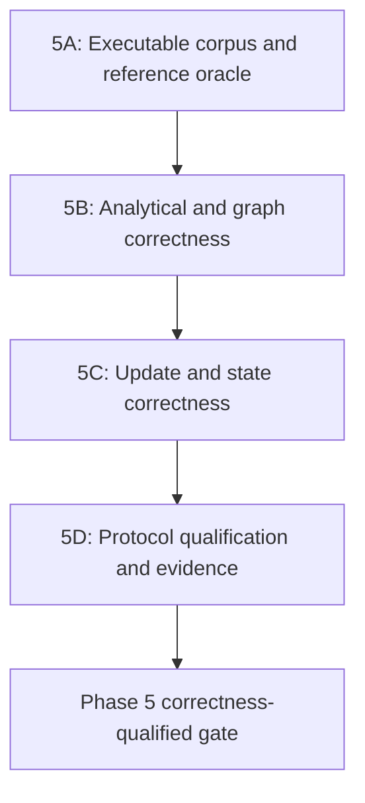

# Phase 5 SNB BI Correctness Qualification Sub-Plan

Description: This sub-plan completes the correctness and qualification work left open after the Phase 5 infrastructure merge. The merged implementation supplies versioned workload contracts, typed parameter bundles, bounded graph primitives, atomic update batches, checkpoints, protocol scheduling, scoring, and artifact generation. This sub-plan turns those boundaries into a complete SNB BI implementation by adding executable translations, accepted-answer oracles, exact analytical handlers, operation-specific graph adapters, complete update mappings, and protocol-wide correctness evidence.

The sub-plan preserves the authority and scope of [the Phase 5 plan](phase-05-snb-business-intelligence.md) and [the Phase 5 validation record](phase-05-validation-record.md). It does not redefine the pinned SNB BI profile or weaken any remaining Phase 5 gate.

---

## Scope and Delivery Rules

Description: These rules keep the follow-up work aligned with the parent plan and prevent partially validated infrastructure from being presented as a comparable benchmark implementation.

- Complete every unchecked Phase 5 item through executable behavior and evidence.
- Keep the SNB BI v1.0.3 catalog, SNB specification v2.2.4 source pin, RDF mapping version, parameter-generator pin, and scoring authority unchanged unless a separate source-pin review explicitly updates them.
- Use the shared `TripleStore.Benchmark.LDBC.Result`, `Correctness`, `Execution`, `Measurement`, and `Artifacts` contracts instead of creating a second benchmark result or reporting model.
- Keep standard analytical operations in the SPARQL/query execution boundary and keep BI 10, 15, 19, and 20 behind explicit graph-extension identifiers.
- Fail corpus construction, execution, correctness comparison, protocol reconciliation, and score generation when mandatory evidence is absent or inconsistent.
- Treat each section as a reviewable commit boundary and each sub-phase as a pull-request boundary.
- End every sub-phase with its integration-test section. A later sub-phase must not begin until the preceding integration gate passes.
- Keep Phase 6 SNB Interactive, external audit preparation, and publication of official or certified results outside this sub-plan.

### Dependency Order

Description: Correctness evidence must be built in this order because handlers cannot be qualified without executable translations and reference answers, update effects cannot be qualified without correct reads, and protocol scoring cannot be qualified before reads and updates agree with the reference state.



### Parent-Plan Traceability

Description: This mapping assigns every remaining parent-plan obligation to one owning sub-phase while allowing later integration gates to reverify earlier behavior.

| Sub-phase | Primary parent-plan coverage |
| --- | --- |
| 5A | 5.1.1.5, 5.1.2.2, reference-oracle prerequisites for 5.4.1.1 and 5.5.1.2 |
| 5B | 5.2.1.1-5.2.1.5, 5.2.2.4, analytical portions of 5.4.2.2-5.4.2.3 |
| 5C | 5.3.1.1, 5.3.1.5, 5.3.2.4, update and reset portions of 5.5.1.3 and 5.5.1.5 |
| 5D | 5.4.1.1, 5.4.2.2-5.4.2.3, 5.5.1.1-5.5.1.5, 5.5.2.2-5.5.2.3, 5.5.3.2-5.5.3.4 |

---

# Sub-Phase 5A: Executable Corpus and Reference Oracle

Description: Sub-Phase 5A turns the metadata-only BI catalog into a deterministic executable corpus and provides the accepted-answer boundary required by every later correctness decision. By the end of this sub-phase, all standard translations parse, every parameter row is validated against both its declared type and referenced store value, and reference results can be loaded and compared through the shared LDBC correctness model.

## Section 5A.1: Versioned Translation Corpus

Description: This section adds auditable TripleStore-owned translations for every standard BI read and variant while retaining the canonical catalog as the authority for parameters, result schemas, ordering, limits, and provenance.

### Task 5A.1.1: Package every standard analytical translation

Description: Create one deterministic translation artifact for each variant of BI 1-9, 11-14, and 16-18 and bind it to the existing `Workload.definition` without duplicating catalog contracts in Elixir source.

- [ ] 5A.1.1.1 Add a translation manifest keyed by canonical operation ID and variant.
- [ ] 5A.1.1.2 Store authored SPARQL translations under a dedicated `priv/benchmarks/ldbc/snb-bi/` hierarchy with stable filenames.
- [ ] 5A.1.1.3 Record the source query card, upstream commit, transformation version, mapping version, and translation checksum for every artifact.
- [ ] 5A.1.1.4 Reject missing, duplicated, unmanifested, or checksum-mismatched translations.
- [ ] 5A.1.1.5 Keep BI 10, 15, 19, and 20 out of the SPARQL corpus and preserve their explicit extension identifiers.

Primary files:

- `priv/benchmarks/ldbc/snb-bi/translations/manifest.exs`
- `priv/benchmarks/ldbc/snb-bi/translations/*.rq`
- `lib/triple_store/benchmark/ldbc/snb/bi/workload.ex`
- `lib/triple_store/benchmark/ldbc/snb/bi/translation_corpus.ex`
- `test/triple_store/benchmark/ldbc/snb_bi_translation_corpus_test.exs`

### Task 5A.1.2: Parse and validate the complete corpus during construction

Description: Make corpus loading prove that every SPARQL artifact parses through the production parser and that its parameters and projected result columns agree with the canonical workload definition.

- [ ] 5A.1.2.1 Parse every translation through `TripleStore.SPARQL.Parser` when the corpus is loaded or validated.
- [ ] 5A.1.2.2 Validate that declared placeholders correspond exactly to the operation parameter contract.
- [ ] 5A.1.2.3 Validate that projected columns cover the declared result schema without missing or unexpected fields.
- [ ] 5A.1.2.4 Reject graph clauses or dataset assumptions that conflict with the Phase 2 named-graph RDF mapping.
- [ ] 5A.1.2.5 Return operation-scoped tagged errors that identify the artifact and failed validation rule.

Primary files:

- `lib/triple_store/benchmark/ldbc/snb/bi/translation_corpus.ex`
- `lib/triple_store/sparql/parser.ex`
- `test/triple_store/benchmark/ldbc/snb_bi_translation_corpus_test.exs`
- `test/triple_store/sparql/parser_test.exs`

## Section 5A.2: Parameter-to-Store Validation

Description: This section extends the existing parameter schema validation with mapped-store reference checks so official and smoke parameter rows cannot silently target missing or incorrectly typed entities.

### Task 5A.2.1: Define parameter reference rules

Description: Associate each operation parameter with the mapped entity, vocabulary value, or unrestricted scalar domain required by the pinned query contract.

- [ ] 5A.2.1.1 Extend translation metadata with reference rules for IDs, countries, tags, tag classes, dates, and other lookup-backed fields.
- [ ] 5A.2.1.2 Distinguish scalar range validation from store-backed identity validation.
- [ ] 5A.2.1.3 Resolve referenced values through dictionary and quad-index lookups instead of scanning decoded RDF documents.
- [ ] 5A.2.1.4 Preserve typed tagged errors for unknown, ambiguous, or graph-inappropriate values.

Primary files:

- `priv/benchmarks/ldbc/snb-bi/translations/manifest.exs`
- `lib/triple_store/benchmark/ldbc/snb/bi/parameter_references.ex`
- `lib/triple_store/benchmark/ldbc/snb/bi/parameters.ex`
- `lib/triple_store/benchmark/ldbc/snb/mapping.ex`
- `test/triple_store/benchmark/ldbc/snb_bi_workload_test.exs`

### Task 5A.2.2: Bind validation to the exact dataset identity

Description: Ensure reference validation runs against the dataset whose checksum and scale factor are already bound into the parameter bundle.

- [ ] 5A.2.2.1 Require the open store and dataset manifest to agree before reference checks begin.
- [ ] 5A.2.2.2 Validate every row in canonical sequence order and report the operation label and row index on failure.
- [ ] 5A.2.2.3 Reject comparable-mode bundles when any referenced store value is absent.
- [ ] 5A.2.2.4 Allow reduced smoke fixtures only through an explicitly identified smoke profile with its own expected references.

Primary files:

- `lib/triple_store/benchmark/ldbc/snb/bi/parameters.ex`
- `lib/triple_store/benchmark/ldbc/snb/bi/parameter_references.ex`
- `lib/triple_store/benchmark/ldbc/dataset_manifest.ex`
- `test/triple_store/benchmark/ldbc/snb_bi_workload_test.exs`

## Section 5A.3: Accepted-Answer Import and Comparison

Description: This section provides one provenance-aware path from pinned reference-engine output to canonical typed `Result` values and complete TripleStore comparisons.

### Task 5A.3.1: Define reference-answer bundles

Description: Package reference rows with the operation, variant, parameter-row identity, dataset checksum, reference implementation, source version, and deterministic content checksum required for later validation.

- [ ] 5A.3.1.1 Define a versioned reference-answer manifest and stable artifact layout.
- [ ] 5A.3.1.2 Import rows without losing numeric widths, timestamps, duplicate multiplicity, or canonical ordering.
- [ ] 5A.3.1.3 Reject answer bundles whose catalog, dataset, mapping, parameter, or source identity differs from the active run.
- [ ] 5A.3.1.4 Commit only small license-compatible smoke answers; keep larger generated answer sets external and manifest-addressed.

Primary files:

- `lib/triple_store/benchmark/ldbc/snb/bi/reference_answers.ex`
- `priv/benchmarks/ldbc/snb-bi/reference/manifest.exs`
- `priv/benchmarks/ldbc/snb-bi/reference/smoke/`
- `test/triple_store/benchmark/ldbc/snb_bi_reference_answers_test.exs`

### Task 5A.3.2: Reuse the shared correctness model

Description: Convert BI materialized results and reference rows into the shared `TripleStore.Benchmark.LDBC.Result` contract before invoking `Correctness.compare/3`.

- [ ] 5A.3.2.1 Remove or adapt duplicate BI-only result representations at the correctness boundary.
- [ ] 5A.3.2.2 Preserve ordered versus unordered comparison, duplicates, exact types, and configured numeric tolerance.
- [ ] 5A.3.2.3 Record full differences for bounded smoke answers and deterministic hashes for larger answers.
- [ ] 5A.3.2.4 Treat missing, malformed, or mismatched reference answers as an invalid run rather than an empty expected result.

Primary files:

- `lib/triple_store/benchmark/ldbc/snb/bi/result_contract.ex`
- `lib/triple_store/benchmark/ldbc/result.ex`
- `lib/triple_store/benchmark/ldbc/correctness.ex`
- `test/triple_store/benchmark/ldbc/snb_bi_reference_answers_test.exs`
- `test/triple_store/benchmark/ldbc/correctness_and_artifacts_test.exs`

## Section 5A.4: Integration Tests

Description: This final section proves that a clean smoke dataset can load the entire executable corpus, validate every parameter reference, and compare deterministic reference answers without relying on unpinned inputs.

### Task 5A.4.1: Validate corpus and parameter completeness

Description: Exercise all 31 canonical variants as one corpus and require complete translation, parameter, and reference coverage.

- [ ] 5A.4.1.1 Load the catalog and prove every standard variant has exactly one parseable translation.
- [ ] 5A.4.1.2 Prove every extension variant has exactly one registered extension identifier and no SPARQL artifact.
- [ ] 5A.4.1.3 Validate good smoke parameter rows against the mapped store.
- [ ] 5A.4.1.4 Inject missing translations, malformed SPARQL, wrong placeholders, missing entities, and mismatched dataset checksums and verify fail-closed errors.

### Task 5A.4.2: Validate reference-answer round trips

Description: Load accepted smoke answers, preserve their typed rows and ordering, and compare them through the shared correctness contract.

- [ ] 5A.4.2.1 Round-trip empty, duplicate-bearing, ordered, timestamp, integer-width, and floating-point results.
- [ ] 5A.4.2.2 Detect missing rows, unexpected rows, wrong ordering, wrong types, and changed provenance.
- [ ] 5A.4.2.3 Verify deterministic checksums across repeated clean-checkout loads.
- [ ] 5A.4.2.4 Record Sub-Phase 5A validation evidence without changing capability entries to supported.

Primary integration test:

- `test/triple_store/benchmark/ldbc/phase_5a_corpus_and_reference_integration_test.exs`

Sub-Phase 5A exit gate:

- Every standard translation parses and matches its catalog contract.
- Every canonical parameter row is type-valid and reference-valid for its bound dataset.
- Reference bundles load into canonical typed results and fail closed on identity mismatch.
- Later phases can use one deterministic operation/parameter/reference tuple as their correctness oracle.

---

# Sub-Phase 5B: Analytical and Graph Correctness

Description: Sub-Phase 5B implements every BI read against the executable corpus and reference oracle created in Sub-Phase 5A. Standard reads execute through the canonical SPARQL stack, graph reads use operation-specific adapters over the merged bounded traversal primitives, and every result must match the designated reference implementation before its capability entry changes.

## Section 5B.1: Semantic Gap Matrix and Regression Baseline

Description: This section determines which translated queries already execute correctly and converts every observed mismatch into a focused behavior regression before changing shared engine semantics.

### Task 5B.1.1: Classify every operation and variant

Description: Execute the complete smoke corpus against the current query engine and classify each variant as passing, parser gap, algebra gap, execution gap, type mismatch, ordering mismatch, or extension-adapter gap.

- [ ] 5B.1.1.1 Produce a stable matrix covering all 31 variants and their expected result bundle.
- [ ] 5B.1.1.2 Capture parse, algebra, optimized plan, execution, and result-contract evidence for each failure.
- [ ] 5B.1.1.3 Group failures by shared engine capability instead of treating every query as an isolated special case.
- [ ] 5B.1.1.4 Keep the matrix generated from test evidence so it cannot drift from operation coverage.

Primary files:

- `lib/triple_store/benchmark/ldbc/snb/bi/qualification.ex`
- `test/triple_store/benchmark/ldbc/snb_bi_qualification_test.exs`
- `notes/planning/ldbc/phase-05-validation-record.md`

### Task 5B.1.2: Add failing regressions for shared semantic gaps

Description: Add the smallest query-engine regressions that reproduce each distinct BI semantic failure before modifying parser, algebra, optimizer, or executor behavior.

- [ ] 5B.1.2.1 Cover required date and duration arithmetic and boundary dates.
- [ ] 5B.1.2.2 Cover string, conditional, numeric-coercion, and aggregate null/empty-set behavior.
- [ ] 5B.1.2.3 Cover nested aggregation, subqueries, grouping, HAVING, ordering, limits, and canonical tie breakers.
- [ ] 5B.1.2.4 Cover numeric widths and RDF-to-BI result type conversion independently of lexical representation.
- [ ] 5B.1.2.5 Link each regression to the affected BI variants and relevant query contract requirement.

Primary files:

- `test/triple_store/sparql/expression_test.exs`
- `test/triple_store/sparql/aggregate_test.exs`
- `test/triple_store/sparql/executor_test.exs`
- `test/triple_store/sparql/query_test.exs`
- `test/triple_store/benchmark/ldbc/snb_bi_qualification_test.exs`

## Section 5B.2: Standard Analytical Handlers

Description: This section implements auditable handlers for BI 1-9, 11-14, and 16-18 using the validated translations and shared query pipeline.

### Task 5B.2.1: Add a complete handler registry

Description: Replace caller-supplied ad hoc handler maps as the normal workload path with a versioned registry that resolves every standard operation and variant to its translation and execution adapter.

- [ ] 5B.2.1.1 Register every standard variant exactly once and reject duplicate or missing handlers.
- [ ] 5B.2.1.2 Bind parameters using typed query bindings rather than textual substitution.
- [ ] 5B.2.1.3 Execute through `TripleStore.SPARQL.Query` and preserve timeout and tagged-error behavior.
- [ ] 5B.2.1.4 Decode and materialize through the canonical BI result contract before correctness comparison.
- [ ] 5B.2.1.5 Keep explicit handler injection available only as a test or expert override with clear precedence.

Primary files:

- `lib/triple_store/benchmark/ldbc/snb/bi/analytics.ex`
- `lib/triple_store/benchmark/ldbc/snb/bi/handler_registry.ex`
- `lib/triple_store/benchmark/ldbc/snb/bi/handlers/`
- `test/triple_store/benchmark/ldbc/snb_bi_analytics_test.exs`

### Task 5B.2.2: Implement general engine semantics exposed by BI

Description: Make the smallest general query-engine changes required by the regression matrix and avoid benchmark-only shortcuts for behavior that belongs to SPARQL execution.

- [ ] 5B.2.2.1 Implement each confirmed expression, datatype, aggregation, subquery, grouping, or ordering gap in its canonical engine module.
- [ ] 5B.2.2.2 Preserve triple and quad schema behavior unless the query feature is explicitly graph-specific.
- [ ] 5B.2.2.3 Return typed errors for unsupported or invalid operations instead of falling back to approximate answers.
- [ ] 5B.2.2.4 Add contract, area-spec, acceptance-criterion, and conformance-scenario updates for every semantic behavior change.
- [ ] 5B.2.2.5 Verify existing non-BI SPARQL tests remain unchanged in meaning.

Primary files:

- `lib/triple_store/sparql/algebra.ex`
- `lib/triple_store/sparql/executor.ex`
- `lib/triple_store/sparql/expression.ex`
- `lib/triple_store/sparql/optimizer.ex`
- `specs/contracts/query_execution_contract.md`
- `specs/query/sparql_execution_pipeline.md`
- `specs/conformance/scenario_catalog.md`

## Section 5B.3: Operation-Specific Graph Adapters

Description: This section turns the merged BFS and Dijkstra primitives into exact BI 10, 15, 19, and 20 operations without extracting the graph into driver memory.

### Task 5B.3.1: Implement unweighted operation adapters

Description: Define candidate selection, edge filtering, path bounds, and result shaping for BI 10 and BI 15 over lazy index-backed neighbour providers.

- [ ] 5B.3.1.1 Map operation parameters to source, target, predicate, graph, and bound inputs.
- [ ] 5B.3.1.2 Preserve operation-specific reachability, distance, disconnected-result, and tie semantics.
- [ ] 5B.3.1.3 Enforce timeout, cancellation, visited-vertex, and intermediate-result limits from the protocol context.
- [ ] 5B.3.1.4 Emit explain and telemetry evidence with the canonical operation identity.

Primary files:

- `lib/triple_store/benchmark/ldbc/snb/bi/graph_algorithms.ex`
- `lib/triple_store/benchmark/ldbc/snb/bi/extensions/read_10.ex`
- `lib/triple_store/benchmark/ldbc/snb/bi/extensions/read_15.ex`
- `test/triple_store/benchmark/ldbc/snb_bi_graph_extensions_test.exs`

### Task 5B.3.2: Implement weighted operation adapters

Description: Define the exact interaction and tag edge weights, endpoint candidates, cost accumulation, and result shaping for BI 19 and BI 20.

- [ ] 5B.3.2.1 Derive edge weights from mapped relationship and message facts without driver-side materialization.
- [ ] 5B.3.2.2 Preserve fractional costs, equal-cost endpoint ties, unreachable pairs, and deterministic ordering.
- [ ] 5B.3.2.3 Reject negative, non-finite, missing, or malformed weights before they enter Dijkstra execution.
- [ ] 5B.3.2.4 Compare full typed results and costs with the designated reference implementation.

Primary files:

- `lib/triple_store/benchmark/ldbc/snb/bi/graph_algorithms.ex`
- `lib/triple_store/benchmark/ldbc/snb/bi/extensions/read_19.ex`
- `lib/triple_store/benchmark/ldbc/snb/bi/extensions/read_20.ex`
- `test/triple_store/benchmark/ldbc/snb_bi_graph_extensions_test.exs`

## Section 5B.4: Capability and Contract Reconciliation

Description: This section changes capability claims only after complete answer evidence exists and keeps the engine contracts synchronized with any generalized query behavior introduced by this sub-phase.

### Task 5B.4.1: Reconcile operation capability entries

Description: Promote each BI read independently when all of its variants parse, execute, materialize, and match accepted answers.

- [ ] 5B.4.1.1 Update standard read entries from `requires_fix` only after all variants pass.
- [ ] 5B.4.1.2 Update graph read entries from `requires_extension` only after the named extension and reference comparisons pass.
- [ ] 5B.4.1.3 Keep incomplete operations fail-closed and retain their blocking rationale.
- [ ] 5B.4.1.4 Make capability-matrix tests derive expected totals from the completed operation evidence.

Primary files:

- `priv/benchmarks/ldbc/capabilities.exs`
- `lib/triple_store/benchmark/ldbc/capability_matrix.ex`
- `test/triple_store/benchmark/ldbc/capability_matrix_test.exs`
- `guides/benchmarks/ldbc-capability-baseline.md`

## Section 5B.5: Integration Tests

Description: This final section proves that every BI read produces the complete expected typed answer across standard and graph-extension execution paths.

### Task 5B.5.1: Validate all read variants

Description: Run all 31 variants against the deterministic smoke dataset and compare every row with the accepted-answer oracle.

- [ ] 5B.5.1.1 Verify columns, types, duplicate multiplicity, row order, limits, and tie breakers.
- [ ] 5B.5.1.2 Exercise empty results, duplicate rows, numeric boundaries, timestamp boundaries, and large intermediate aggregations.
- [ ] 5B.5.1.3 Verify parser, execution, timeout, cancellation, and result-contract failures invalidate the operation.
- [ ] 5B.5.1.4 Reopen the store and reproduce the same answer hashes.

### Task 5B.5.2: Validate graph operations against a reference

Description: Cross-check distance, reachability, path bounds, weighted cost, equal-cost ties, and disconnected graphs for all four extension operations.

- [ ] 5B.5.2.1 Compare small exhaustive graph fixtures with an independent reference algorithm.
- [ ] 5B.5.2.2 Compare mapped SNB smoke results with the pinned reference implementation.
- [ ] 5B.5.2.3 Verify limit and cancellation exits release iterators and do not leave background work.
- [ ] 5B.5.2.4 Record Sub-Phase 5B answer digests and capability transitions in the validation record.

Primary integration test:

- `test/triple_store/benchmark/ldbc/phase_5b_read_correctness_integration_test.exs`

Sub-Phase 5B exit gate:

- Every standard and graph BI read has a registered implementation.
- Every variant matches its accepted typed and ordered answer.
- Query-engine changes carry regression tests and synchronized contract traceability.
- The capability matrix contains no unverified promotion.

---

# Sub-Phase 5C: Update and State Correctness

Description: Sub-Phase 5C completes the generated BI update vocabulary, proves atomic mapped-RDF effects, and makes checkpoint and run artifacts identify the exact update state. It depends on Sub-Phase 5B because selected post-update query answers are part of the update correctness oracle.

## Section 5C.1: Complete Update Record Mapping

Description: This section inventories and implements every canonical insert and delete record emitted by the pinned BI update generator.

### Task 5C.1.1: Define the complete update schema catalog

Description: Make generated record coverage explicit and versioned so unknown record shapes cannot be ignored or partially translated.

- [ ] 5C.1.1.1 Catalog every insert and delete record type, required field, relationship endpoint, property, and dependency.
- [ ] 5C.1.1.2 Bind the catalog to the pinned generator and RDF mapping versions.
- [ ] 5C.1.1.3 Reject unknown fields, missing required fields, duplicate record identities, and out-of-order dependencies.
- [ ] 5C.1.1.4 Verify fixture coverage includes at least one record of every mandatory type.

Primary files:

- `priv/benchmarks/ldbc/snb-bi/updates/manifest.exs`
- `lib/triple_store/benchmark/ldbc/snb/update_stream.ex`
- `lib/triple_store/benchmark/ldbc/snb/bi/update_schema.ex`
- `test/triple_store/benchmark/ldbc/snb_bi_update_schema_test.exs`

### Task 5C.1.2: Translate every insert and delete to mapped RDF mutations

Description: Convert each validated record into canonical quad puts and deletes while preserving graph identity, relationship properties, and within-batch ordering.

- [ ] 5C.1.2.1 Reuse `SNB.Mapping` entity and relationship rules for inserts.
- [ ] 5C.1.2.2 Define exact delete keys for entity facts, relationship facts, and relationship properties.
- [ ] 5C.1.2.3 Reject deletion plans that cannot prove complete mapped-RDF cleanup.
- [ ] 5C.1.2.4 Submit one ordered mixed RocksDB batch through the existing `UpdateBatch` boundary.
- [ ] 5C.1.2.5 Run cache and statistics invalidation only after a successful commit.

Primary files:

- `lib/triple_store/benchmark/ldbc/snb/mapping.ex`
- `lib/triple_store/benchmark/ldbc/snb/bi/update_schema.ex`
- `lib/triple_store/benchmark/ldbc/snb/bi/update_batch.ex`
- `test/triple_store/benchmark/ldbc/snb_bi_update_batch_test.exs`

## Section 5C.2: Post-Update State Probes

Description: This section proves that each accepted microbatch produces the expected graph state and query-visible answers rather than relying only on storage-batch success.

### Task 5C.2.1: Add deterministic count and identity probes

Description: Measure entity, relationship, graph, and selected property counts at the initial state and after each smoke microbatch.

- [ ] 5C.2.1.1 Define expected state probes in versioned fixture metadata.
- [ ] 5C.2.1.2 Validate inserted identities and relationships through indexed lookups.
- [ ] 5C.2.1.3 Validate deleted identities, relationships, and properties are absent from every relevant explicit index.
- [ ] 5C.2.1.4 Detect stale cache or statistics observations after commit.

Primary files:

- `lib/triple_store/benchmark/ldbc/snb/bi/state_probe.ex`
- `priv/benchmarks/ldbc/fixtures/snb-bi/updates/`
- `test/triple_store/benchmark/ldbc/snb_bi_update_batch_test.exs`

### Task 5C.2.2: Re-run affected BI answers after updates

Description: Associate each representative microbatch with the BI reads it can affect and compare their complete post-update answers with the reference engine.

- [ ] 5C.2.2.1 Select affected reads from actual mapped predicates and entities rather than a hard-coded timing list.
- [ ] 5C.2.2.2 Compare full post-update rows after every smoke batch checkpoint.
- [ ] 5C.2.2.3 Verify failed batches preserve all pre-batch counts, answers, cache generations, and statistics state.
- [ ] 5C.2.2.4 Include the batch sequence and resulting state checksum in correctness evidence.

Primary files:

- `lib/triple_store/benchmark/ldbc/snb/bi/state_probe.ex`
- `lib/triple_store/benchmark/ldbc/snb/bi/qualification.ex`
- `test/triple_store/benchmark/ldbc/snb_bi_update_answers_test.exs`

## Section 5C.3: Checkpoint and Artifact State Identity

Description: This section makes every checkpoint and run artifact identify the exact applied update position and graph-state checksum used by later protocol stages.

### Task 5C.3.1: Standardize state identity

Description: Define one immutable state-identity record shared by checkpoints, protocol execution, correctness evidence, and final artifacts.

- [ ] 5C.3.1.1 Include dataset checksum, mapping version, checkpoint name, last applied batch, update-stream checksum, and state checksum.
- [ ] 5C.3.1.2 Compute the state checksum from deterministic persisted evidence rather than process-local ordering.
- [ ] 5C.3.1.3 Reject checkpoint restore or protocol continuation when any state field disagrees.
- [ ] 5C.3.1.4 Preserve closed-store checkpoint creation and restore ownership.

Primary files:

- `lib/triple_store/benchmark/ldbc/snb/bi/checkpoint.ex`
- `lib/triple_store/benchmark/ldbc/snb/bi/state_identity.ex`
- `lib/triple_store/benchmark/ldbc/snb/bi/protocol.ex`
- `test/triple_store/benchmark/ldbc/snb_bi_update_batch_test.exs`

### Task 5C.3.2: Reconcile state identity across artifacts

Description: Emit the same state identity in driver records, correctness records, checkpoint metadata, manifest data, and disclosure artifacts.

- [ ] 5C.3.2.1 Add state identity to every validation, power, and throughput block.
- [ ] 5C.3.2.2 Reject artifact generation when block state identities are missing or inconsistent.
- [ ] 5C.3.2.3 Make state identity available in both machine-readable JSON and the Markdown report.
- [ ] 5C.3.2.4 Preserve schema-version handling for existing non-BI artifact consumers.

Primary files:

- `lib/triple_store/benchmark/ldbc/artifacts.ex`
- `lib/triple_store/benchmark/ldbc/snb/bi/protocol.ex`
- `lib/triple_store/benchmark/ldbc/snb/bi/state_identity.ex`
- `test/triple_store/benchmark/ldbc/correctness_and_artifacts_test.exs`

## Section 5C.4: Integration Tests

Description: This final section applies representative canonical microbatches, validates every state transition, restores all named checkpoints, and proves failure atomicity.

### Task 5C.4.1: Validate successful state transitions

Description: Apply the complete smoke update sequence and compare counts, identities, affected answers, update positions, and checksums after every batch.

- [ ] 5C.4.1.1 Cover every mandatory update record type.
- [ ] 5C.4.1.2 Verify all explicit quad indices agree after inserts and deletes.
- [ ] 5C.4.1.3 Verify selected affected BI answers match the reference state.
- [ ] 5C.4.1.4 Restore each named checkpoint and reproduce its counts, answers, and state checksum.

### Task 5C.4.2: Validate failure and reset behavior

Description: Inject translation, dependency, storage, invalidation, interruption, and restore failures and prove no invalid state advances into a later protocol stage.

- [ ] 5C.4.2.1 Verify pre-commit failures leave persisted state unchanged.
- [ ] 5C.4.2.2 Verify storage-batch failure leaves every explicit index unchanged.
- [ ] 5C.4.2.3 Verify failed post-commit maintenance is reported with the committed state identity and cannot be scored as complete.
- [ ] 5C.4.2.4 Reset to the initial checkpoint and reproduce the original answer hashes exactly.

Primary integration test:

- `test/triple_store/benchmark/ldbc/phase_5c_update_state_integration_test.exs`

Sub-Phase 5C exit gate:

- Every mandatory update record type has a validated mapped-RDF translation.
- Successful batches match reference counts and affected answers.
- Failed batches cannot leave partial explicit-index state or advance the protocol.
- Checkpoints and artifacts agree on update position and deterministic state identity.

---

# Sub-Phase 5D: Protocol Qualification, Optimization, and Evidence

Description: Sub-Phase 5D runs the complete validated workload through canonical protocol schedules, reconciles all evidence, performs answer-preserving optimization from measured plans, and closes the Phase 5 gate. Comparable terminology remains unavailable until every correctness and protocol prerequisite passes.

## Section 5D.1: Complete Validation Execution

Description: This section executes every canonical BI read and representative update transition using the official validation parameter sequence where available and the deterministic smoke profile in clean-checkout coverage.

### Task 5D.1.1: Run complete validation blocks

Description: Replace reduced read subsets with complete ordered execution of all 31 variants and the required update placements.

- [ ] 5D.1.1.1 Consume parameter rows in the pinned canonical sequence.
- [ ] 5D.1.1.2 Record start state, end state, operation identity, parameter-row identity, result checksum, duration, and correctness status for every operation.
- [ ] 5D.1.1.3 Stop the block on parse, execution, timeout, update, or correctness failure.
- [ ] 5D.1.1.4 Exclude warmup, failed, timed-out, incorrect, or incomplete operations from score inputs.

Primary files:

- `lib/triple_store/benchmark/ldbc/snb/bi/protocol.ex`
- `lib/triple_store/benchmark/ldbc/snb/bi/qualification.ex`
- `test/triple_store/benchmark/ldbc/snb_bi_protocol_test.exs`

### Task 5D.1.2: Exercise correctness boundaries

Description: Expand the validation corpus to cover conditions likely to expose false agreement or unstable results.

- [ ] 5D.1.2.1 Cover empty and duplicate-bearing results.
- [ ] 5D.1.2.2 Cover disconnected and equal-cost graph cases.
- [ ] 5D.1.2.3 Cover integer overflow boundaries, floating-point tolerance, large aggregation groups, canonical ties, and limit boundaries.
- [ ] 5D.1.2.4 Re-run after store reopen and after initial-state restore to verify stable hashes.

Primary files:

- `priv/benchmarks/ldbc/fixtures/snb-bi/`
- `priv/benchmarks/ldbc/snb-bi/reference/smoke/`
- `test/triple_store/benchmark/ldbc/snb_bi_boundary_cases_test.exs`

## Section 5D.2: Protocol and Scoring Reconciliation

Description: This section proves that the canonical driver schedule, TripleStore execution records, checkpoint state, and scoring inputs describe the same operations and durations.

### Task 5D.2.1: Reconcile protocol records

Description: Validate one-to-one agreement among scheduled, started, completed, failed, and scored operations across every validation, power, and throughput block.

- [ ] 5D.2.1.1 Reconcile operation count, variant order, parameter position, update placement, and block boundaries.
- [ ] 5D.2.1.2 Reconcile driver timestamps with measured execution durations and exclude setup or artifact time.
- [ ] 5D.2.1.3 Reconcile every block with its checkpoint and state identity.
- [ ] 5D.2.1.4 Reject duplicate, missing, reordered, stale-state, or unpaired records.

Primary files:

- `lib/triple_store/benchmark/ldbc/snb/bi/protocol.ex`
- `lib/triple_store/benchmark/ldbc/snb/bi/protocol_reconciler.ex`
- `test/triple_store/benchmark/ldbc/snb_bi_protocol_test.exs`

### Task 5D.2.2: Prove local scoring equivalence

Description: Compare the local scorer with the pinned official scoring path using checked-in golden raw durations and malformed-input cases.

- [ ] 5D.2.2.1 Capture license-compatible golden inputs and expected outputs from the pinned official tool.
- [ ] 5D.2.2.2 Compare power, scale-adjusted power, throughput, and scale-adjusted throughput within the specified numeric tolerance.
- [ ] 5D.2.2.3 Verify incomplete blocks, invalid durations, incorrect answers, stale state, and insufficient throughput duration fail identically.
- [ ] 5D.2.2.4 Record scorer identity and input checksum in score artifacts.

Primary files:

- `lib/triple_store/benchmark/ldbc/snb/bi/scoring.ex`
- `priv/benchmarks/ldbc/snb-bi/scoring/`
- `test/triple_store/benchmark/ldbc/snb_bi_scoring_equivalence_test.exs`

## Section 5D.3: Evidence-Driven Optimization

Description: This section tunes only correctness-qualified operations and accepts changes only when complete answer digests remain identical.

### Task 5D.3.1: Rank validated cost centers

Description: Use existing plan evidence to identify high-cardinality joins, inaccurate estimates, excessive materialization, repeated expressions, grouping, top-k, and graph-traversal costs.

- [ ] 5D.3.1.1 Capture comparable plan and resource evidence for every operation under one stable environment manifest.
- [ ] 5D.3.1.2 Rank improvements by measured elapsed time, iterator count, materialized rows, memory, and I/O.
- [ ] 5D.3.1.3 Separate dataset-statistics errors from executor and algorithm costs.
- [ ] 5D.3.1.4 Defer low-impact or benchmark-specific cleanup that does not improve a general engine capability.

Primary files:

- `lib/triple_store/benchmark/ldbc/snb/bi/plan_evidence.ex`
- `lib/triple_store/sparql/cardinality.ex`
- `lib/triple_store/sparql/quad_cardinality.ex`
- `lib/triple_store/sparql/optimizer.ex`
- `test/triple_store/benchmark/ldbc/snb_bi_optimization_test.exs`

### Task 5D.3.2: Implement answer-preserving improvements

Description: Apply measured statistics, planning, grouping, top-k, repeated-expression, and path optimizations through general engine boundaries.

- [ ] 5D.3.2.1 Add a plan or cost regression before each optimizer change.
- [ ] 5D.3.2.2 Preserve complete typed answer digests and protocol eligibility after every change.
- [ ] 5D.3.2.3 Preserve bounded resource cleanup on success, early halt, timeout, cancellation, and failure.
- [ ] 5D.3.2.4 Reject latency improvements when correctness or plan-evidence completeness regresses.

Primary files:

- `lib/triple_store/sparql/optimizer.ex`
- `lib/triple_store/sparql/cost_model.ex`
- `lib/triple_store/sparql/join_enumeration.ex`
- `lib/triple_store/benchmark/ldbc/snb/bi/graph_algorithms.ex`
- `test/triple_store/sparql/cost_optimizer_integration_test.exs`
- `test/triple_store/benchmark/ldbc/snb_bi_optimization_test.exs`

## Section 5D.4: Qualification Artifacts and Claims

Description: This section assembles the complete evidence set and changes Phase 5 status only when every mandatory operation and gate is proven.

### Task 5D.4.1: Generate complete qualification artifacts

Description: Produce result, correctness, score-input, environment, resource, state, and disclosure artifacts with mutually consistent checksums and schema versions.

- [ ] 5D.4.1.1 Include every operation and variant in the catalog and correctness artifacts.
- [ ] 5D.4.1.2 Include dataset, mapping, translation, parameter, reference-answer, update-stream, checkpoint, scorer, and environment identities.
- [ ] 5D.4.1.3 Validate artifact checksums and cross-file operation counts after writing.
- [ ] 5D.4.1.4 Preserve diagnostic naming for reduced smoke runs and comparable naming only for protocol-complete runs.

Primary files:

- `lib/triple_store/benchmark/ldbc/artifacts.ex`
- `lib/triple_store/benchmark/ldbc/snb/bi/qualification.ex`
- `test/triple_store/benchmark/ldbc/correctness_and_artifacts_test.exs`

### Task 5D.4.2: Close the Phase 5 capability gate

Description: Verify that the operation catalog contains no unimplemented mandatory BI operation before updating the parent plan, validation record, capability matrix, and benchmark guide.

- [ ] 5D.4.2.1 Require every mandatory read, variant, and update family to have implementation and correctness evidence.
- [ ] 5D.4.2.2 Require all parent-plan checkboxes owned by this sub-plan to pass from executable evidence.
- [ ] 5D.4.2.3 Record exact commands, operation counts, parameter counts, reductions, exclusions, checksums, and remaining claim limits.
- [ ] 5D.4.2.4 Update documentation without using official, certified, or audited terminology unless the external process has occurred.

Primary files:

- `priv/benchmarks/ldbc/capabilities.exs`
- `notes/planning/ldbc/phase-05-snb-business-intelligence.md`
- `notes/planning/ldbc/phase-05-validation-record.md`
- `guides/benchmarks/ldbc-snb-bi.md`
- `guides/benchmarks/ldbc-capability-baseline.md`

## Section 5D.5: Integration Tests

Description: This final section runs the full Phase 5 gate from a clean deterministic state and proves that correctness, update state, protocol records, scoring inputs, and artifacts agree.

### Task 5D.5.1: Run the complete smoke qualification

Description: Execute corpus validation, parameter validation, all reads, representative update batches, checkpoint restoration, protocol reconciliation, scoring equivalence, and artifact validation as one fail-fast workflow.

- [ ] 5D.5.1.1 Run all 31 variants with complete typed reference comparisons.
- [ ] 5D.5.1.2 Apply and validate every mandatory update record family represented in the smoke fixture.
- [ ] 5D.5.1.3 Reproduce initial answer hashes after full reset.
- [ ] 5D.5.1.4 Inject incorrect answers, missing handlers, failed updates, timeouts, stale checkpoints, scorer mismatches, and incomplete artifacts and verify the run is ineligible.

### Task 5D.5.2: Pass repository-wide quality gates

Description: Verify the completed implementation against project formatting, compilation, test, static-analysis, documentation, and governance requirements.

- [ ] 5D.5.2.1 Run focused corpus, parameter, analytics, graph, update, protocol, scoring, and artifact tests.
- [ ] 5D.5.2.2 Run the complete default test suite and deliberately included relevant excluded tags.
- [ ] 5D.5.2.3 Run strict compilation, formatting, Credo, and Dialyzer.
- [ ] 5D.5.2.4 Run specs, guides, RFC, code-doc, and conformance governance validators.
- [ ] 5D.5.2.5 Confirm generated native binaries, large external datasets, and generated reference corpora remain untracked.

Primary integration test:

- `test/triple_store/benchmark/ldbc/phase_5d_qualification_integration_test.exs`

Sub-Phase 5D and Phase 5 exit gate:

- Every mandatory BI read, variant, and update family is implemented and correctness-qualified.
- Full ordered answers agree with the designated reference implementation.
- Protocol, checkpoint, state, timing, and scoring records reconcile exactly.
- Local scoring matches pinned golden official outputs for the tested inputs.
- Artifact validation passes and claim terminology matches the actual profile.
- The parent Phase 5 gate is complete and Phase 6 may begin.

---

## Deferred Implementation Decisions

Description: These decisions depend on failures and measurements observed during implementation and should be resolved inside the owning sub-phase without changing the sub-plan's correctness requirements.

- The exact grouping of standard read handler modules may follow shared semantic families when that reduces duplication without hiding operation ownership.
- The exact SPARQL engine modules changed in Sub-Phase 5B depend on the regression matrix; do not modify parser, algebra, optimizer, or executor surfaces without a failing behavior test.
- The exact state-checksum implementation depends on which persisted metadata surfaces are required to prove update identity; it must remain deterministic across reopen and restore.
- Optimization targets and acceptance thresholds must come from Sub-Phase 5D measurements and may not be invented before all answers are qualified.

## Final Verification Contract

Description: The following repository checks define the minimum final evidence for the sub-plan in addition to the phase-specific integration gates.

```sh
mix format --check-formatted
./scripts/compile_strict.sh
mix test test/triple_store/benchmark/ldbc/snb_bi_*_test.exs
mix test test/triple_store/benchmark/ldbc/phase_5*_integration_test.exs
mix test
mix credo --strict
mix dialyzer --format short
./scripts/validate_specs_governance.sh
./scripts/validate_guides_governance.sh
./scripts/validate_rfc_governance.sh
./scripts/validate_code_docs.sh
./scripts/run_conformance.sh
```

The final validation record must report exact executed commands, toolchain overrides, failures, skips, and excluded test tags. A default `mix test` run alone does not establish complete benchmark qualification.
